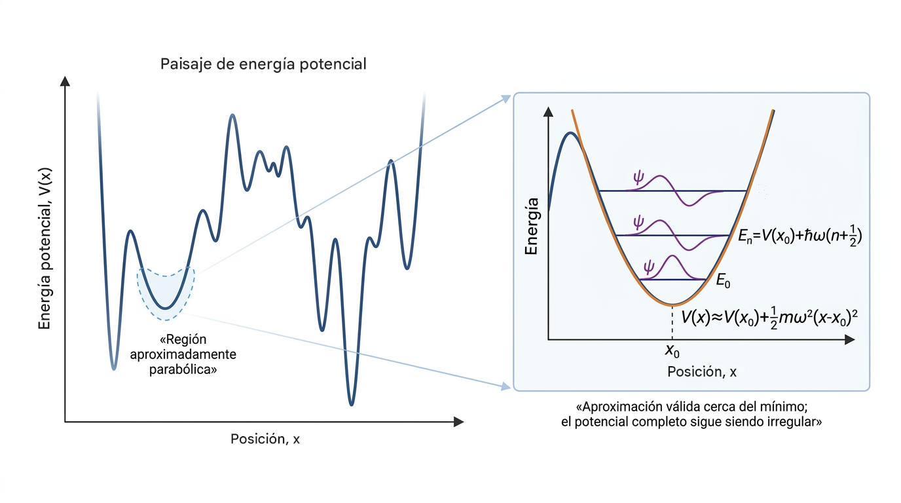

# Oscilador Armónico Cuántico

!!! info "Información del documento"
    - **Área:** Física, Mecánica Cuantica
    - **Autoría:** Campaña Vergara Jackson
    - **Última actualización:** 31/10/26
    - **Estado:** [✏ Borrador]

## Prerrequisitos

- [Añade aquí los conceptos previos y enlaza las páginas existentes.]

## Resumen
Uno de los sistemas físicos de mayor interés teórico, el oscilador armónico, cuya energia potencial es $V=\frac{1}{2}k x^2$. Para simplificar el tratamiento nos restringimos al caso unidimensional, que carece de degeneración (el oscilador armónico en más de una dimensión es un problema degenerado que, para su tratamiento cabal, requiere en la teoría clásica de la teoría del momento angular, la que habremos de desarrollar mas adelante). 

El oscilador armónico suministra importante información acerca de las vibraciones atómicas en las moléculas y los sólidos dado que aparece cuando potenciales más o menos complicados se aproximan en la región de un mínimo con curvas parabólicas. Por lo tanto, se trata esencialmente de la teoría de oscilaciones poco energéticas en torno a un mínimo de potencial, situación que se da con frecuencia con átomos, moléculas, etc. Además, el empleo frecuente del análisis de Fourier para estudiar sistemas complejos en términos de osciladores elementales hace del oscilador armónico uno de los problemas más importantes de la física teórica, sin considerar su interés metodológico debido al hecho de poseer solución exacta bajo la ecuación de schrodinger:
\[ \frac{-\hbar^2}{2m} \frac{d^2}{dx^2} \Psi + \frac{1}{2} \Psi = E \Psi\]

Imagen hecha con **figurelabs**

??? Conceptos fundamentales
    A primera vista, la elección de un potencial proporcional a la posición al cuadrado, $V(x) = \frac{1}{2}m\omega^2 x^2$, evoca directamente al resorte clásico de la ley de Hooke. Sin embargo, su relevancia en física cuántica vamucho más allá de un simple resorte. En la naturaleza, cualquier sistema cuántico cerca de un punto de equilibrio estable (como los átomos vibrando dentro de una molécula o en una red cristalina) puede aproximarse mediante un potencial parabólico al truncar su expansión en serie de Taylor a segundo orden.

Este modelo surge de preguntarse que pasa si la energía potencial es parabólica, y dense cuenta de lo interesante del asunto, dado que el operador energía cinética $\hat{T}=-(\hbar/2m)\nabla^2$ en mecánica clásica es estrictamente positivo 

---

### Definiciones

Ecuación de Schrodinger: $\frac{-\hbar^2}{2m} \nabla^2 \Psi + V(\vec{r}) \Psi = E \Psi$

---

# Solución del Oscilador Armónico Cuántico

El Hamiltoniano del oscilador armónico en una dimensión (1D) está dado por:

$$
\left( -\frac{\hbar^2}{2m} \frac{d^2}{dx^2} + \frac{1}{2}m\omega^2 x^2 \right) \psi(x) = E \psi(x)
$$

Reordenando para aislar la derivada de mayor orden:

$$
\frac{d^2\psi(x)}{dx^2} - \frac{m^2\omega^2}{\hbar^2} x^2 \psi(x) + \frac{2mE}{\hbar^2} \psi(x) = 0
$$

Definimos las constantes físicas estándar con dimensiones apropiadas:

* $a^2 = \frac{m\omega}{\hbar} \implies a^4 = \frac{m^2\omega^2}{\hbar^2}$
* $k^2 = \frac{2mE}{\hbar^2}$

Obtenemos la ecuación diferencial reestructurada:

$$
\mathbf{\frac{d^2\psi(x)}{dx^2} - a^4 x^2 \psi(x) + k^2 \psi(x) = 0}
$$

---

### Cambio de Variable Hacia la Ecuación Confluente

Aplicando la transformación $y = a^2 x^2$:

$$
\frac{dy}{dx} = 2a^2 x = 2a y^{1/2} \implies \frac{df}{dx} = \frac{dy}{dx}\frac{df}{dy} = 2a y^{1/2} \frac{df}{dy}
$$

Calculando la segunda derivada:

$$
\frac{d^2 f}{dx^2} = 2a y^{1/2} \frac{d}{dy}\left(2a y^{1/2} \frac{df}{dy}\right) = 4a^2 y \frac{d^2 f}{dy^2} + 2a^2 \frac{df}{dy}
$$

Sustituyendo en la ecuación diferencial principal:

$$
\left( 4a^2 y \frac{d^2\psi}{dy^2} + 2a^2 \frac{d\psi}{dy} \right) - a^4 \left(\frac{y}{a^2}\right)\psi + k^2 \psi = 0
$$

Dividiendo toda la ecuación entre $4a^2$:

$$
y \frac{d^2\psi}{dy^2} + \frac{1}{2} \frac{d\psi}{dy} + \left( \frac{k^2}{4a^2} - \frac{y}{4} \right) \psi(y) = 0
$$

Definimos el parámetro adimensional de energía $\mathcal{E}$:

$$
\mathcal{E} \equiv \frac{k^2}{2a^2} = \frac{\frac{2mE}{\hbar^2}}{2\frac{m\omega}{\hbar}} = \mathbf{\frac{E}{\hbar\omega}}
$$

Sustituyendo $\frac{k^2}{4a^2} = \frac{\mathcal{E}}{2}$, obtenemos la ecuación intermedia:

$$
\mathbf{y \frac{d^2\psi(y)}{dy^2} + \frac{1}{2} \frac{d\psi(y)}{dy} + \left( \frac{\mathcal{E}}{2} - \frac{y}{4} \right) \psi(y) = 0} \quad (*)
$$

---

### Comportamiento Asintótico $e^{-y/2}$ (Ecuación de Kummer)

Para grandes valores de $y$, la ecuación dominante toma la forma:

$$
\lim_{y \to \infty} \left[ \frac{d^2\psi(y)}{dy^2} + \frac{1}{2y} \frac{d\psi(y)}{dy} + \left( \frac{\mathcal{E}}{2y} - \frac{1}{4} \right) \psi(y) \right] = 0 \implies \frac{d^2\psi(y)}{dy^2} - \frac{1}{4} \psi(y) = 0
$$

Esto sugiere una solución asintótica de la forma $\psi(y) = e^{-y/2} w(y)$ para valores grandes de $y$, recordando que $y = x^2 \geq 0$. Con esta propuesta, acoplamos dicho comportamiento asintótico a una función propuesta $w(y)$ que dictará el comportamiento de la solución en regiones cercanas al origen. 

Calculamos las derivadas de $\psi(y) = e^{-y/2} w(y)$:

$$
\psi' = e^{-y/2} \left( w' - \frac{1}{2}w \right) \qquad \psi'' = e^{-y/2} \left( w'' - w' + \frac{1}{4}w \right)
$$

Sustituyendo en la ecuación intermedia $(*)$ y simplificando el factor común $e^{-y/2}$:

$$
y \left( w'' - w' + \frac{1}{4}w \right) + \frac{1}{2} \left( w' - \frac{1}{2}w \right) + \left( \frac{\mathcal{E}}{2} - \frac{y}{4} \right) w = 0
$$

Desarrollando los términos:

$$
y w'' - y w' + \frac{y}{4}w + \frac{1}{2} w' - \frac{1}{4}w + \frac{\mathcal{E}}{2}w - \frac{y}{4}w = 0
$$

$$
y w'' + \left(\frac{1}{2} - y\right) w' - \left( \frac{1}{4} - \frac{\mathcal{E}}{2} \right) w = 0
$$

Llegamos exactamente a la **Ecuación Hipergeométrica Confluente (de Kummer)**:

$$
\mathbf{y \frac{d^2 w(y)}{dy^2} + (b - y) \frac{dw(y)}{dy} - a \, w(y) = 0}
$$

La cual es capaz de entregar una solución basada en polinomios especiales según los parámetros $a$ y $b$ involucrados en el problema. Es una forma generalizada desde la cual se obtiene la solución mediante los Polinomios de Hermite, donde:

$$
b = \frac{1}{2}, \qquad a = \frac{1}{4} - \frac{\mathcal{E}}{2} = \mathbf{\frac{1}{4} - \frac{E}{2\hbar\omega}}
$$

---

### Transformación a la Variable Espacial $\xi = \sqrt{y}$ (Ecuación de Hermite)

Si en lugar de $y$ empleamos la coordenada espacial adimensional $\xi = ax = \sqrt{\frac{m\omega}{\hbar}} x$:

$$
\frac{d\xi}{dy} = \frac{1}{2}y^{-1/2} \implies \frac{df}{dy} = \frac{1}{2\xi} \frac{df}{d\xi}
$$

Calculando las derivadas correspondientes:

$$
\frac{dw}{dy} = \frac{1}{2\xi}\frac{dw}{d\xi} \qquad \frac{d^2w}{dy^2} = \frac{1}{2\xi}\frac{d}{d\xi}\left(\frac{1}{2\xi}\frac{dw}{d\xi}\right) = \frac{1}{2\xi}\left(-\frac{1}{2\xi^2}\frac{dw}{d\xi} + \frac{1}{2\xi}\frac{d^2w}{d\xi^2}\right)
$$

Expresando la ecuación de Kummer en términos de la variable espacial $\xi$:

$$
-\frac{1}{4\xi}\frac{dw}{d\xi} + \frac{1}{4}\frac{d^2w}{d\xi^2} + \frac{1}{4\xi}\frac{dw}{d\xi} - \frac{\xi}{2}\frac{dw}{d\xi} - \left(\frac{1}{4} - \frac{\mathcal{E}}{2}\right) w(\xi) = 0
$$

Simplificando los términos, obtenemos la **Ecuación Diferencial de Hermite**:

$$
\mathbf{\frac{d^2 w(\xi)}{d\xi^2} - 2\xi \frac{dw(\xi)}{d\xi} + (2\mathcal{E} - 1) w(\xi) = 0}
$$

**NOTA:** Claramente se pudo obtener directamente este resultado pero es interesante observar como surgen los polinomios de hermite de la ecuación hipergeométrica confluente (Ec. de Kummer).

Con esto concluimos que la solución general del oscilador armónico cuántico es muy parecida a la ecuación de los **Polinomios de Hermite** $H_n(\xi)$. Solo si $2\mathcal{E} - 1=2n$ con $n$ un numero entero positivo, a rigor falta demostrar la discretización de este termino para que la solución de la función de valores cercanos al origen $w(\xi)$ es efectivamente dada por dichos polinomios.

Para demostrarlo supondremos la solución de $w(\xi)$ en forma de una serie de potencias en forma del metodo de Frobenious.

---

### **Proponemos la solución de Frobenius en la forma general:**

Proponemos la solución en serie de potencias en la forma general de Frobenius para $w(\xi)$:

$$w(\xi) = \sum_{k=0}^{\infty} c_k \xi^{k+s} \quad (c_0 \neq 0)$$

Sustituyendo $w(\xi)$, $w'(\xi)$ y $w''(\xi)$ en la ecuación diferencial de Hermite:

$$\frac{d^2 w}{d\xi^2} - 2\xi \frac{dw}{d\xi} + (2\mathcal{E} - 1)w = 0$$

$$\sum_{k=0}^{\infty} (k+s)(k+s-1)c_k \xi^{k+s-2} - 2\sum_{k=0}^{\infty} (k+s)c_k \xi^{k+s} + (2\mathcal{E} - 1)\sum_{k=0}^{\infty} c_k \xi^{k+s} = 0$$

$$\sum_{k=-2}^{\infty} (k+s+2)(k+s+1)c_{k+2} \xi^{k+s} + \sum_{k=0}^{\infty} [-2(k+s)c_k + (2\mathcal{E} - 1) c_k]\xi^{k+s} = 0$$

$$\underbrace{(s)(s-1)c_{0} \xi^{s-2} + (s+1)(s)c_{1} \xi^{s-1}}_{términos \quad sobrantes \quad =0} + \sum_{k=0}^{\infty} [(k+s+2)(k+s+1)c_{k+2} -2(k+s)c_k + (2\mathcal{E} - 1) c_k ]\xi^{k+s} = 0$$

Para eliminar los términos sobrantes tomamos $s=0$, con ello la serie queda limpia y obtenemos la **relación de recurrencia** para $k \ge 0$.

$$(k+2)(k+1)c_{k+2} -2(k)c_k + (2\mathcal{E} - 1) c_k =0$$

$$c_{k+2} = \frac{2k - (2\mathcal{E} - 1)}{(k+1)(k+2)} c_k$$

Como el salto en los subíndices es de $k \to k+2$, la paridad queda **completamente desacoplada**:

* Los coeficientes pares ($c_0, c_2, c_4, \dots$) dependen **únicamente de $c_0$**.

* Los coeficientes impares ($c_1, c_3, c_5, \dots$) dependen **únicamente de $c_1$**.

---

??? Divergencia de la Solución sin Truncamiento

Partimos de la relación de recurrencia exacta para la rama:

$$c_{2m+2} = \frac{4m - (2\mathcal{E} - 1)}{(2m+1)(2m+2)} c_{2m}$$

Si la serie no se trunca, existe un entero $M \in \mathbb{N}$ tal que para todo $m \ge M$, el numerador $4m - (2\mathcal{E}-1) > 0$. A partir de este índice $M$, todos los coeficientes $c_{2m}$ tienen el mismo signo (asumamos positivo $c_{2m} > 0$ sin pérdida de generalidad).Tomemos el cociente para $m \ge M$:

$$\frac{c_{2m+2}}{c_{2m}} = \frac{4m - (2\mathcal{E} - 1)}{4m^2 + 6m + 2}$$

Para cualquier valor fijo de $\mathcal{E}$, existe un número entero $K \ge M$ y una constante positiva $\gamma > 0$ tal que para todo $m \ge K$:$$\frac{c_{2m+2}}{c_{2m}} \ge \frac{\gamma}{m+1}$$

Por inducción directa para $m \ge K$, esto implica la existencia de una constante estricta $A > 0$ tal que:$$c_{2m} \ge \frac{A}{m!} \quad \text{para todo } m \ge K$$

Acotación Inferior de la Función $w(\xi)$ Dado que todos los términos de la serie para $m \ge K$ son estrictamente positivos cuando $\xi \in \mathbb{R}$, podemos acotar la función $w(\xi)$ por abajo mediante la suma parcial a partir del término $K$:

$$w(\xi) = \sum_{m=0}^{K-1} c_{2m} \xi^{2m} + \sum_{m=K}^{\infty} c_{2m} \xi^{2m}$$Para $\vert{}\xi\vert{} \ge 1$, el primer sumatorio finito está acotado por un polinomio $P(\xi)$. Para el segundo sumatorio, aplicamos nuestra cota inferior de coeficientes $c_{2m} \ge \frac{A}{m!}$:

$$\sum_{m=K}^{\infty} c_{2m} \xi^{2m} \ge A \sum_{m=K}^{\infty} \frac{(\xi^2)^m}{m!} = A \left( e^{\xi^2} - \sum_{m=0}^{K-1} \frac{\xi^{2m}}{m!} \right)$$P

or lo tanto, existe un punto $\xi_0 > 0$ tal que para todo $\vert{}\xi\vert{} > \xi_0$, se cumple rigurosamente la desigualdad estricta:

$$w(\xi) \ge \frac{A}{2} e^{\xi^2}$$

Criterio de Integrabilidad para la Norma en $L^2(\mathbb{R})$

Evaluemos la norma al cuadrado de $\psi(\xi)$ utilizando la regla de monotonía de la integral de Lebesgue sobre el dominio $(-\infty, -\xi_0] \cup [\xi_0, \infty

Vert{}\psi\Vert{}^2 = \int_{-\infty}^{\infty} [w(\xi)]^2 e^{-\xi^2} d\xi \ge \int_{\vert{}\xi\vert{} > \xi_0} [w(\xi)]^2 e^{-\xi^2} d\xi$$Sustituyendo la acotación inferior estricta $w(\xi) \ge \frac{A}{2} e^{\xi^2}$:

$$\Vert{}\psi\Vert{}^2 \ge \int_{\vert{}\xi\vert{} > \xi_0} \left( \frac{A}{2} e^{\xi^2} \right)^2 e^{-\xi^2} d\xi$$

$$\Vert{}\psi\Vert{}^2 \ge \frac{A^2}{4} \int_{\vert{}\xi\vert{} > \xi_0} e^{2\xi^2} e^{-\xi^2} d\xi = \frac{A^2}{4} \int_{\vert{}\xi\vert{} > \xi_0} e^{+\xi^2} d\xi$$Dado que $e^{+\xi^2} \ge 1$ para todo $\xi$:$$\Vert{}\psi\Vert{}^2 \ge \frac{A^2}{4} \int_{\xi_0}^{\infty} 1 \, d\xi = +\infty$$

## Cuantización Inevitable de $(2\mathcal{E} - 1)$

Para evitar que la serie $w(\xi)$ sea infinita y diverja asintóticamente como $e^{\xi^2}$ (lo que destruiría la normalizabilidad de la función de onda total $\psi(\xi) = w(\xi)e^{-\xi^2/2}$), la serie debe **truncarse** en un polinomio de grado finito $N$.

Esto requiere que el numerador de la recurrencia sea cero para un índice entero $k = N$:

$$2N - (2\mathcal{E} - 1) = 0 \implies 2\mathcal{E} - 1 = 2N \quad \text{con } N \in \{0, 1, 2, 3, \dots\}$$

Llamando $n = N$ al grado del Polinomio de Hermite $H_n(\xi)$:

$$2\mathcal{E} - 1 = 2n$$

Despejando la energía adimensional $\mathcal{E} = \frac{E}{\hbar\omega}$:

$$2\mathcal{E} = 2n + 1 \implies \mathcal{E} = n + \frac{1}{2}$$

### Resultado Final de la Energía

$$\mathbf{E_n = \left(n + \frac{1}{2}\right)\hbar\omega \quad (n = 0, 1, 2, \dots)}$$

---

## Conclusión

El uso directo de $s = 0$ demuestra que no es estrictamente necesario separar $s = 1$ y $s = 0$ como dos casos independientes. La estructura del salto $k+2$ en la recurrencia de $s = 0$ separa naturalmente a la función $w(\xi)$ en sus componentes par e impar, y la exigencia física de normalizabilidad fuerza a que $2\mathcal{E}-1$ sea un entero par no negativo, cuantizando la energía de forma automática.

## 📄 Visor de las Notas de Clase y Demostraciones

  <object
    data="../../../assets/pdf/Clase_OsciladorArmonico1D.pdf#toolbar=1&navpanes=0&scrollbar=1"
    type="application/pdf"
    width="100%"
    height="100%">
    
Tu navegador no soporta la vista previa. <a href="../../../assets/pdf/Clase_OsciladorArmonico1D.pdf">Descargar PDF</a>

  </object>

---

## Desarrollo en tres niveles de rigor

=== "1. Intuición"
    [Explica la idea con palabras, ejemplos o diagramas.]

=== "2. Desarrollo estándar"
    [Presenta el desarrollo habitual para un curso universitario.]

=== "3. Fundamentación rigurosa"
    [Expón las hipótesis, definiciones formales y demostraciones completas.]

### Resultados principales

[Enuncia los teoremas, leyes o relaciones importantes.]

## Ejemplos y aplicaciones

[Añade ejemplos resueltos y aplicaciones.]

## Ejercicios

1. [Enunciado del ejercicio]

## Referencias

- [Añade aquí libros, artículos o recursos consultados.]

## 📥 Recursos de la Clase

[📥 Descargar PDF de la Clase](../../../assets/pdf/Osc_Cuantico_1D.pdf){ .md-button .md-button--primary }

[📦 Descargar Código Fuente TeX (.zip)](../../../clases_zip/Osc_Cuantico_1D.zip){ .md-button }
