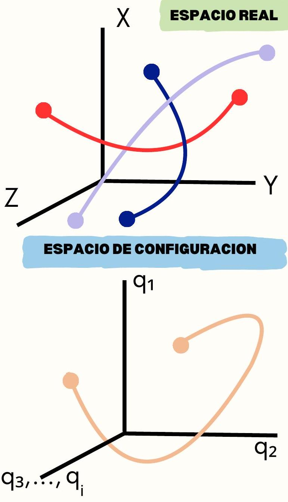
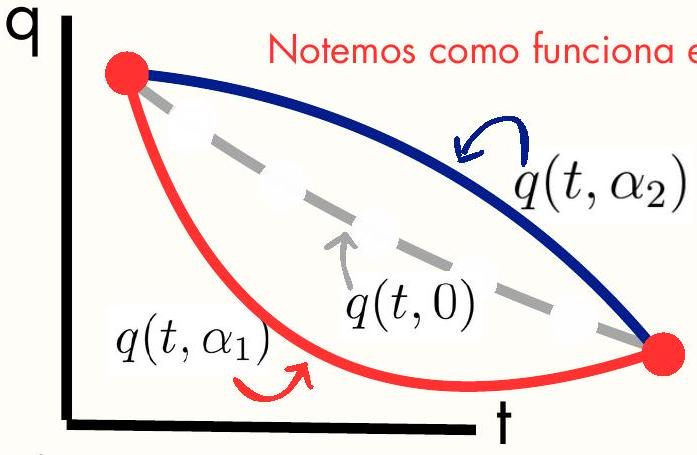

## 1. ESPACIOS DE CONFIGURACION

Espacio real hace referencia al uso de las coordenadas comunes y corrientes, distinguen las tres dimensiones espaciales las cuales estamos acostumbrados y describimos el sistema bajo dichas coordenadas.
Espacio de configuración es el formado por las k coordenadas generalizadas, lo cual formaría un hiper-espacio de k dimensiones, con lo cual se podría describir el movimiento de dicho sistema bajo una sola trayectoria en este nuevo espacio. El propósito de esto es describir el movimiento del sistema bajo una sola trayectoria, una sola curva. Y asi definir el funcional acción.

Condensamos todas las coordenadas generlizadas independientes y a cada una se le asigna una recta numerica, ose una dimension en este hiper-espacio

## SEMANA 02: FORMULACIÓN HAMILTONIANA

## 2. PRINCIPIO DE HAMILTON

Es un principio integral donde la el movimiento del sistema esta dado por fuerzas (excepto las ligaduras) que derivan de un potencial. Y si el sistema es conservativo el principio anuncia que:

$$
I=\int_{t_{1}}^{t_{2}} L d t
$$

El movimiento que el sistema realiza entre dos instantes de tiempos esta dado por la integral curvilínea donde el lagrangiano tiene un valor estacionario, por ello es equivalente a escribir...

$$
\delta I=\delta \int_{t_{1}}^{t_{2}} L d t=0
$$

## 4. MULTIPLICADORES DE LAGRANGE

Sistemas no Conservativos:
Nos encontramos ante un sistema no conservativo si las fuerzas que intervienen no provienen de un potencial.

Método de Multiplicadores de Lagrange:
Si las ligaduras son no holonomas por ser de una forma diferencial no integrable, pero se pueden plantear de forma variacional con a las coordenadas generalizadas, y luego hallaremos una forma de describir la ligadura k-esima en base a

$$
\sum_{j=1}^{n} C_{k j} \delta q_{j}=0
$$

Los Ckj son funciones de las coordenadas y velocidades generalizadas, tales que se forma la ligadura k-esima
Ahora introducimos los multiplicadores de lagrange, funciones de coordenas y/o velocidades generalidas que escogeremos con el fin de anualr terminos
Luego las integramos a las ec. de Euler-Lagrange y luego los m primeros $\lambda$ son seleccionas tal que anulen los primeros m sumandos

$$
\sum_{j=m+1}^{n}\left[\frac{\partial L}{\partial q_{j}}-\frac{d}{d t}\left(\frac{\partial L}{\partial \dot{q}_{j}}\right)+\sum_{k} \lambda_{k} C_{k j}\right] \delta q_{j}=0
$$

## 3. PRINCIPIOS VARIACIONALES

Notar que la acción es un funcional, osea un grupo de diferentes funciones. Para representar a los diferentes caminos que describe este funcional en el sistema en el espacio de configuraciones consideramos lo siguiente:

$$
\begin{aligned}
q\left(t_{1}\right) & =h_{1}, q\left(t_{2}\right)=h_{2} \\
q(t, \alpha) & =q(t, 0)+\alpha \eta(t) \\
\eta\left(t_{1}\right) & =\eta\left(t_{2}\right)=0
\end{aligned}
$$

Donde $\eta$ es una función cualquiera que sea continua y diferenciable. Y a es un parametro arbitrario.

De forma análoga a buscar un punto critico de una función, el principio de Hamilton trata de buscar un punto critico del funcional, osea que sea estacionario De ello que la acción que realizara el sistema tiene que ser tal que...

$$
\frac{\partial I(\alpha)}{\partial \alpha}=0
$$

Matemáticamente significa que la razon de cambio respecto a la variación de $a$ es 0 , osea la curva mas 'rígida' es la empleada por la naturaleza Despues un tratamiento matematico y usar el lema fundamental del calculo variacional se puede llegar a las ecuaciones de Euler-Lagrange

Ahora los $\lambda$ son conocidos y las variaciones de las coordenadas sobrantes ahora son independientes, por ello...

$$
\begin{gathered}
\frac{\partial L}{\partial q_{j}}-\frac{d}{d t}\left(\frac{\partial L}{\partial \dot{q}_{j}}\right)+\sum_{k} \lambda_{k} C_{k j}=0 \\

## Referencias Bibliograficas

- Mecánica Analítica - (Gantmajer)

- Cálculo Variacional - M. Krasnov.

- Mecánica Analítica - H. Goldstein
\frac{d}{d t}\left(\frac{\partial L}{\partial \dot{q}_{j}}\right)-\frac{\partial L}{\partial q_{j}}=Q_{j}^{n c}
\end{gathered}
$$

