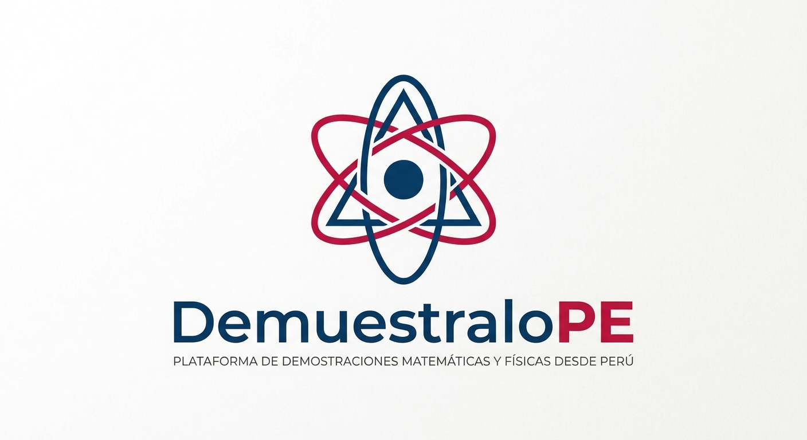

# DemuestraloPE: Presentación

*Enciclopedia abierta de demostraciones, teoremas y notas de clase.*

---

## 🎯 Visión del Proyecto
**DemuestraloPE** es una iniciativa académica colaborativa impulsada por estudiantes y sin fines de lucro. Nuestro objetivo es recopilar, discutir y formalizar el conocimiento de **Matemáticas y Física** por el momento, luego se piensa añadir **Química, Estadística, etc**. combinando la intuición e ideas tempranas del conocimiento con el rigor y formalismo matemático estricto.

Antes que nada, vale la pena recalcar la gran importancia que tiene saber demostrar, tómenlo como un simple solucionario a ello, donde los pasos intermedios y argumentos que suelen quedar en el aire son finalmente tratados, y siempre se estará abierto a dialogar y aclarar posibles errores en el material presentado.

Hoy en día el conocimiento esta al **alcance de todos**, pero también encontramos basta **desinformación**. Con ese propósito recopilamos diversas explicaciones en temas de la física y matemática, pasando por explicaciones mas **conceptuales** para iniciar en el tema y diferentes **niveles de rigor** en las demostraciones de teoremas o resultados importantes en las ramas de la ciencia.

Exploramos las diferentes capas de profundidad que puede tener un tema que a primeras pensaríamos simple, y observamos la simpleza y belleza de modelos de la física y matemática que pueden parecer complicados a primera vista, puesto que no existe tema complicado, sino temas no comprendidos, justo ese primer contacto con algo desconocido puede ser aterrador o simplemente dar pereza, pero lo importante es empezar a hacer por tu cuenta las cosas, y nunca dejar de preguntar, que esa curiosidad nunca muera, .

Sintetizar y organizar lo conocido sobre diferentes temas, **ahorramos tiempo y esfuerzos** al estudiante al solo necesitar enfocarse en entender, es decir el fin es proporcionar una **estructura clara** en como escalar y estudiar cierto tema de su interés.

---

## 🧠 Estructura de los Niveles de Rigor
Al navegar en los diferentes temas y cursos encontrara que el enfoque está organizado en diferentes niveles conceptuales y matemáticos:
Por obvias razones no siempre encontraremos la misma estructura en la rigurosidad de las demostraciones o pasos intermedios, por ello para que el conocimiento sea accesible, siempre que sea posible y necesario para su entendimiento, detallamos los temas con la siguiente estructura.

1. **Intuición y Visualización**  
   Representaciones geométricas, diagramas simples y explicaciones sin fuerte sustento matemático.
2. **Rigor Físico y Matemático**  
   Desarrollo formal estándar al nivel de asignaturas universitarias.
3. **Fundamentación Axiomática**  
   Demostraciones avanzadas a partir de principios, axiomas y leyes de la naturaleza.
4. **Filosofia en la Ciencia**
   Expandir de ciertos temas por esta area permite analizar y concluir hechos interesantes en la naturaleza.
---

## 🤝 ¿Cómo colaborar?
1. Navega a la asignatura correspondiente en el menú superior.
2. Haz clic en el ícono del lápiz (**Editar en GitHub**) en cualquier página.
3. Agrega tus notas en Markdown y LaTeX.
4. Contacto: Mandar un correo a la siguiente direccion: jscampanav@unitru.edu.pe
5. Envía tu contribución mediante un **Pull Request**.
